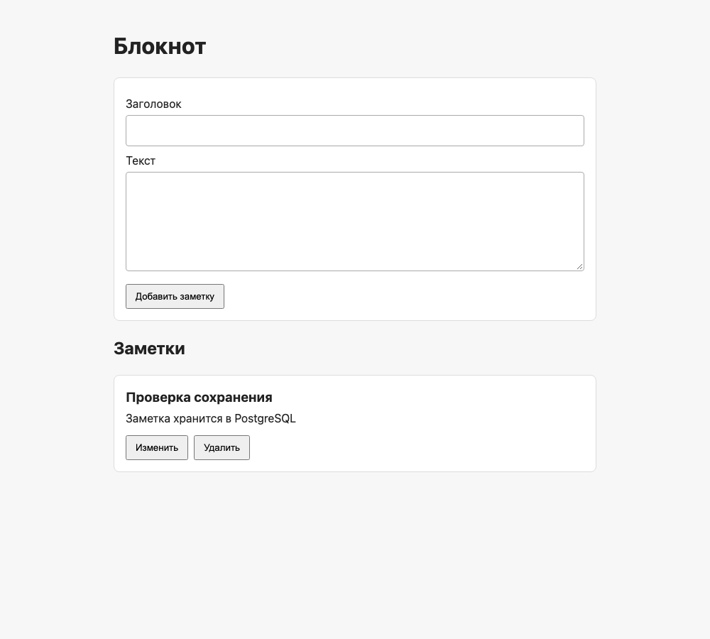

# Лабораторная 0 — свой сервис

## Цель

Поднять локально приложение из фронтенда, бэкенда и отдельной сетевой базы данных; сохранить запись через страницу и убедиться, что она остаётся после обновления.

## Устройство

Страница `frontend/index.html` с минимальными CSS и JavaScript обращается через `fetch` к Flask API из `backend/app.py`. В лабораторной 0 Flask также отдаёт файлы страницы по `/static`. Flask выполняет SQL-запросы к PostgreSQL по TCP через `127.0.0.1:55432`. PostgreSQL работает в собственном контейнере Docker Desktop и сохраняет данные в именованном томе `devops_lab0_notes_data`. Таблица `notes` содержит `id`, `title`, `content`; Flask создаёт её при запуске, если таблицы ещё нет. Реализованы создание, список, изменение и удаление заметок.

## Запуск

Полные команды первого и повторного запуска приведены в [README](../README.md). В текущей структуре используются:

```zsh
docker run --name devops-lab0-postgres --env-file .env -p 127.0.0.1:55432:5432 -v devops_lab0_notes_data:/var/lib/postgresql/data -d postgres:16
docker exec devops-lab0-postgres pg_isready -U notebook -d notebook
python3 -m venv .venv
.venv/bin/python -m pip install -r backend/requirements.txt
set -a
source .env
set +a
.venv/bin/python backend/app.py
```

`.env` содержит случайный локальный пароль и не включён в репозиторий. Пароль и полный идентификатор контейнера в отчёте не приводятся.

## Реальные проверки

| Проверка | Команда или действие | Результат |
| --- | --- | --- |
| Готовность PostgreSQL | `docker exec devops-lab0-postgres pg_isready -U notebook -d notebook` | `/var/run/postgresql:5432 - accepting connections` |
| Страница и JavaScript | `curl -i http://127.0.0.1:8000/`, `curl -I http://127.0.0.1:8000/static/app.js` | Оба ответа `200 OK` |
| Пустой список перед записью | `curl -sS http://127.0.0.1:8000/api/notes` | `[]` |
| Создание | `curl -X POST http://127.0.0.1:8000/api/notes -H 'Content-Type: application/json' --data '{"title":"Проверка сохранения","content":"Заметка хранится в PostgreSQL"}'` | Создана заметка `id=1`; последующий `GET /api/notes` вернул её |
| Хранение в PostgreSQL | `docker exec devops-lab0-postgres psql -U notebook -d notebook -c 'SELECT id, title, content FROM notes ORDER BY id;'` | Строка `1 | Проверка сохранения | Заметка хранится в PostgreSQL` |
| Изменение | Создана заметка `id=2`; `curl -X PUT http://127.0.0.1:8000/api/notes/2 -H 'Content-Type: application/json' --data '{"title":"Изменённая заметка","content":"Новый текст"}'` | Ответ и последующий `GET` содержали изменённые поля |
| Удаление | `curl -X DELETE http://127.0.0.1:8000/api/notes/2` | HTTP `204`; последующий `GET` не содержал `id=2` |
| Браузер | Google Chrome 156, загрузка страницы и действия с формой и кнопками | Сохранённая заметка появилась в DOM; форма создала новую запись; после обновления страницы запись осталась; изменение и удаление через кнопки прошли |

Проверка браузерных действий выполнена во временном сценарии Chrome DevTools Protocol вне проекта. Он нажимал элементы страницы и отправлял форму; результат подтверждён DOM страницы и запросами к Flask. Повторить вручную: открыть `http://127.0.0.1:8000/`, создать заметку, обновить страницу, изменить её и удалить.

### Повторная проверка после переноса файлов

Flask повторно запущен командой `.venv/bin/python backend/app.py` с тем же `.env` и контейнером PostgreSQL. Код HTML, CSS, JavaScript и SQL-операций не менялся; исправлен только путь Flask к `frontend/`.

| Проверка | Фактический результат |
| --- | --- |
| `curl` для `/`, `/static/app.js`, `/static/style.css` | Все три ответа HTTP `200` |
| `GET /api/notes` перед тестом | Сохранившиеся записи `id=1` и `id=5` присутствовали |
| `POST /api/notes` | Создана отдельная тестовая заметка `id=6` |
| `GET /api/notes` | Вернул `id=6` вместе с прежними заметками |
| `PUT /api/notes/6` и SQL `SELECT ... WHERE id = 6` | Изменённые поля `Изменено после переноса` и `Обновлено через API` видны непосредственно в PostgreSQL |
| `DELETE /api/notes/6` и следующий `GET` | HTTP `204`; тестовой записи в списке больше нет, прежние записи сохранились |
| Chrome: форма, обновление страницы, редактирование и удаление | Все действия прошли; созданная через форму заметка оставалась после обновления страницы. Браузерный сценарий удалил только свою тестовую заметку. |

## Скриншот

Реальный снимок работающей страницы в Chrome после загрузки сохранённой заметки:



## Репозиторий

Репозиторий с кодом: [Marselo555/DevOps_Lab_ITMO](https://github.com/Marselo555/DevOps_Lab_ITMO).
