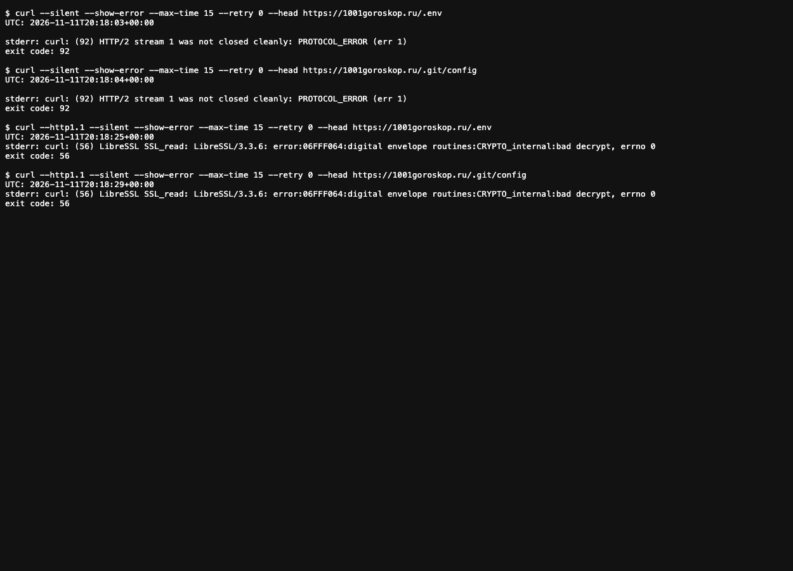
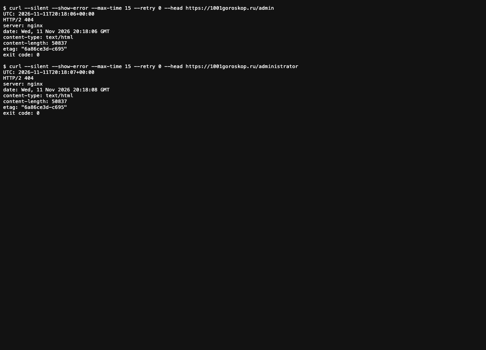
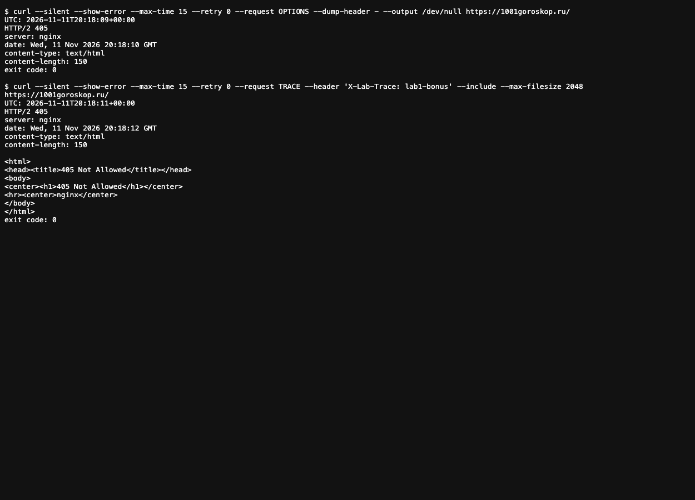

# Лабораторная 1★ — проверка безопасности Nginx

## Цель и условия

В этой работе я проверил, не открывает ли веб-сервер обычному посетителю служебные файлы и административные страницы и как он обрабатывает методы OPTIONS и TRACE. По заданию достаточно провести три проверки, записать ответы и объяснить результат, даже если доступ получить не удалось.

Для проверки выбран [1001goroskop.ru](https://1001goroskop.ru/) — открытый сайт с гороскопами. Запросы отправлялись с macOS 11 ноября 2026 года около 23:18 по московскому времени. В ответах был заголовок `server: nginx`, но по нему нельзя установить версию сервера или всю его конфигурацию. Контрольный запрос `curl --silent --show-error --head --max-time 15 --retry 0 https://1001goroskop.ru/` вернул `HTTP/2 200`: на момент проверки главная страница отвечала.

Я заранее выбрал пути и не использовал сканер, перебор паролей или нагрузочные запросы. Для служебных и административных путей применялся `HEAD`: он запрашивает заголовки без тела ответа. Редиректы не отслеживались. Команды, ответы, ошибки и коды завершения `curl` сохранены в `evidence/lab1-bonus-*.txt`.

## Служебные файлы

Если сервер отдаёт `.env` или `.git/config` посетителю, могут раскрыться настройки приложения или репозитория. Я запросил только HTTP-статус, без содержимого файлов.

```zsh
curl --silent --show-error --max-time 15 --retry 0 --head https://1001goroskop.ru/.env
curl --silent --show-error --max-time 15 --retry 0 --head https://1001goroskop.ru/.git/config
curl --http1.1 --silent --show-error --max-time 15 --retry 0 --head https://1001goroskop.ru/.env
curl --http1.1 --silent --show-error --max-time 15 --retry 0 --head https://1001goroskop.ru/.git/config
```

Оба запроса через HTTP/2 завершились без HTTP-статуса: `curl: (92) HTTP/2 stream 1 was not closed cleanly: PROTOCOL_ERROR (err 1)`. Повтор через HTTP/1.1 тоже не дал статуса: `curl: (56) LibreSSL SSL_read: LibreSSL/3.3.6: error:06FFF064:digital envelope routines:CRYPTO_internal:bad decrypt, errno 0`. Коды завершения `curl` были соответственно 92 и 56. Это диагностические ошибки клиента при обмене с сервером, а не ответы HTTP 403 или 404. По ним нельзя установить, существуют ли файлы, защищены ли они и были бы доступны при успешном соединении. Ошибка TLS сама по себе не доказывает уязвимость.

Результат первой проверки **неопределённый**: раскрытие файлов не подтверждено, но и их недоступность этими ответами установить нельзя. [Полный вывод](evidence/lab1-bonus-files.txt) и снимок открытого протокола:



## Административные разделы

Здесь я искал административную страницу, доступную без авторизации. Проверил два заранее выбранных пути, `/admin` и `/administrator`, без перебора других адресов и учётных данных.

```zsh
curl --silent --show-error --max-time 15 --retry 0 --head https://1001goroskop.ru/admin
curl --silent --show-error --max-time 15 --retry 0 --head https://1001goroskop.ru/administrator
```

Оба ответа начинались с `HTTP/2 404`, содержали `server: nginx`, `content-type: text/html` и `content-length: 50837`. Код 404 означает, что по этим адресам ресурс не найден или сервер не раскрывает его существование таким запросом. Значение `content-length` относится к телу ответа, которое `HEAD` не скачивал; оно не свидетельствует о доступе к панели. `curl` завершился с кодом 0, потому что HTTP-ответ был получен корректно, а опция `--fail` не использовалась.

Без авторизации доступ к двум проверенным адресам **не получен**. Результат ничего не говорит о других административных путях или о том, как устроен вход на сайт. [Полный вывод](evidence/lab1-bonus-admin.txt) и снимок:



## Методы OPTIONS и TRACE

`OPTIONS` позволяет узнать, какие способы обращения к ресурсу разрешены; его поддержка сама по себе не является уязвимостью. Риск возникает, если сервер без нужды раскрывает сведения или разрешает опасные операции. `TRACE` предназначен для диагностики: сервер может вернуть клиенту исходный запрос. Если в таком ответе отражаются чувствительные заголовки, их можно раскрыть. Я отправил один запрос каждым методом к главной странице. В запросе TRACE был только безвредный маркер `X-Lab-Trace: lab1-bonus`, без cookie и данных авторизации.

```zsh
curl --silent --show-error --max-time 15 --retry 0 --request OPTIONS --dump-header - --output /dev/null https://1001goroskop.ru/
curl --silent --show-error --max-time 15 --retry 0 --request TRACE --header 'X-Lab-Trace: lab1-bonus' --include --max-filesize 2048 https://1001goroskop.ru/
```

Оба запроса получили `HTTP/2 405`. В ответе OPTIONS не было заголовка `Allow`; из него нельзя вывести список разрешённых методов. Ответ TRACE содержал короткую HTML-страницу `405 Not Allowed`, а не отражённый запрос: маркер `X-Lab-Trace` в теле ответа не появился. Код 405 означает, что сервер не разрешил эти методы для проверенного адреса. Нулевой код завершения `curl` здесь также означает получение корректного HTTP-ответа, а не успешное выполнение метода.

В этих двух запросах **признаков уязвимости не обнаружено**. Проверена только главная страница в указанное время. [Полный вывод](evidence/lab1-bonus-methods.txt) и снимок:



## Вывод

Три проверки проведены на выбранном сайте без изменения его настроек. `/admin` и `/administrator` ответили 404; OPTIONS и TRACE на главной странице — 405. Доступ к служебным файлам проверить до HTTP-статуса не удалось из-за ошибок протокола и TLS. Подтверждённой уязвимости в этих опытах нет, но первая проверка осталась без определённого вывода, а остальные охватывают только указанные пути и момент времени.

Для снимков я открыл сохранённые текстовые протоколы `curl` в headless Chrome. Системный `screencapture` не смог получить изображение дисплея, поэтому PNG показывают реальные сохранённые результаты, а не окно терминала во время запроса.
