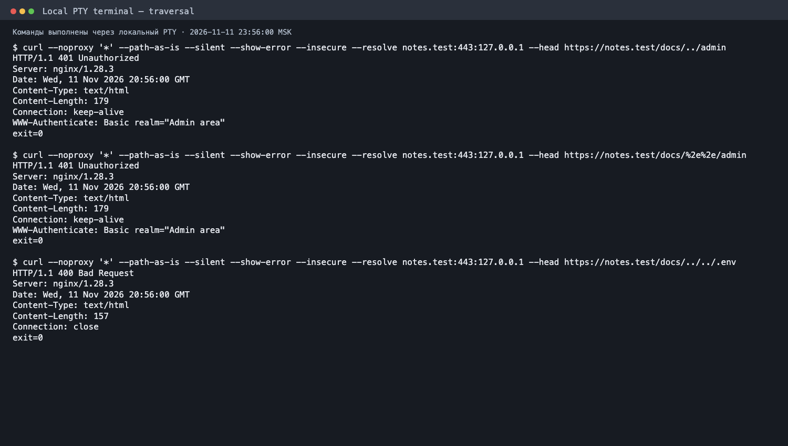

# Лабораторная 1★ — проверка безопасности Nginx

## Цель и условия

В этой работе я проверил доступ к административным страницам, обработку методов OPTIONS и TRACE и возможность обхода пути `/docs/`. Отдельная попытка проверить служебные файлы осталась без HTTP-ответа. По заданию достаточно провести три завершённые проверки, записать ответы и объяснить результат, даже если доступ получить не удалось.

Первые запросы направлялись к [1001goroskop.ru](https://1001goroskop.ru/) — открытому сайту с гороскопами. Они отправлялись с macOS 11 ноября 2026 года около 23:18 по московскому времени. В ответах был заголовок `server: nginx`, но по нему нельзя установить версию сервера или всю его конфигурацию. Контрольный запрос `curl --silent --show-error --head --max-time 15 --retry 0 https://1001goroskop.ru/` вернул `HTTP/2 200`: на момент проверки главная страница отвечала. После неопределённого результата для служебных файлов третью проверку я провёл на собственном локальном Nginx `notes.test`, которым могу управлять. Результаты двух площадок не смешиваются.

Я заранее выбрал пути и не использовал сканер, перебор паролей или нагрузочные запросы. Для служебных и административных путей применялся `HEAD`: он запрашивает заголовки без тела ответа. Редиректы не отслеживались. Команды, ответы, ошибки и коды завершения `curl` сохранены в `evidence/lab1-bonus-*.txt`.

## Служебные файлы

Если сервер отдаёт `.env` или `.git/config` посетителю, могут раскрыться настройки приложения или репозитория. Я запросил только HTTP-статус, без содержимого файлов.

```zsh
curl --silent --show-error --max-time 15 --retry 0 --head https://1001goroskop.ru/.env
curl --silent --show-error --max-time 15 --retry 0 --head https://1001goroskop.ru/.git/config
curl --http1.1 --silent --show-error --max-time 15 --retry 0 --head https://1001goroskop.ru/.env
curl --http1.1 --silent --show-error --max-time 15 --retry 0 --head https://1001goroskop.ru/.git/config
```

Оба запроса через HTTP/2 завершились без HTTP-статуса: `curl: (92) HTTP/2 stream 1 was not closed cleanly: PROTOCOL_ERROR (err 1)`. Повтор через HTTP/1.1 тоже не дал статуса: `curl: (56) LibreSSL SSL_read: LibreSSL/3.3.6: error:06FFF064:digital envelope routines:CRYPTO_internal:bad decrypt, errno 0`. Коды завершения `curl` были соответственно 92 и 56. Это диагностические ошибки клиента при обмене с сервером, а не ответы HTTP 403 или 404. По ним нельзя установить, существуют ли файлы, защищены ли они и были бы доступны при успешном соединении. Ошибка TLS сама по себе не доказывает уязвимость.

Результат этой попытки **неопределённый**: раскрытие файлов не подтверждено, но и их недоступность этими ответами установить нельзя. Она не засчитывается как завершённая проверка. [Полный вывод](evidence/lab1-bonus-files.txt) и снимок открытого протокола:


## Административные разделы

Здесь я искал административную страницу, доступную без авторизации. Проверил два заранее выбранных пути, `/admin` и `/administrator`, без перебора других адресов и учётных данных.

```zsh
curl --silent --show-error --max-time 15 --retry 0 --head https://1001goroskop.ru/admin
curl --silent --show-error --max-time 15 --retry 0 --head https://1001goroskop.ru/administrator
```

Оба ответа начинались с `HTTP/2 404`, содержали `server: nginx`, `content-type: text/html` и `content-length: 50837`. Код 404 означает, что по этим адресам ресурс не найден или сервер не раскрывает его существование таким запросом. Значение `content-length` относится к телу ответа, которое `HEAD` не скачивал; оно не свидетельствует о доступе к панели. `curl` завершился с кодом 0, потому что HTTP-ответ был получен корректно, а опция `--fail` не использовалась.

Без авторизации доступ к двум проверенным адресам **не получен**. Результат ничего не говорит о других административных путях или о том, как устроен вход на сайт. [Полный вывод](evidence/lab1-bonus-admin.txt) и снимок:


## Методы OPTIONS и TRACE

`OPTIONS` позволяет узнать, какие способы обращения к ресурсу разрешены; его поддержка сама по себе не является уязвимостью. Риск возникает, если сервер без нужды раскрывает сведения или разрешает опасные операции. `TRACE` предназначен для диагностики: сервер может вернуть клиенту исходный запрос. Если в таком ответе отражаются чувствительные заголовки, их можно раскрыть. Я отправил один запрос каждым методом к главной странице. В запросе TRACE был только безвредный маркер `X-Lab-Trace: lab1-bonus`, без cookie и данных авторизации.

```zsh
curl --silent --show-error --max-time 15 --retry 0 --request OPTIONS --dump-header - --output /dev/null https://1001goroskop.ru/
curl --silent --show-error --max-time 15 --retry 0 --request TRACE --header 'X-Lab-Trace: lab1-bonus' --include --max-filesize 2048 https://1001goroskop.ru/
```

Оба запроса получили `HTTP/2 405`. В ответе OPTIONS не было заголовка `Allow`; из него нельзя вывести список разрешённых методов. Ответ TRACE содержал короткую HTML-страницу `405 Not Allowed`, а не отражённый запрос: маркер `X-Lab-Trace` в теле ответа не появился. Код 405 означает, что сервер не разрешил эти методы для проверенного адреса. Нулевой код завершения `curl` здесь также означает получение корректного HTTP-ответа, а не успешное выполнение метода.

В этих двух запросах **признаков уязвимости не обнаружено**. Проверена только главная страница в указанное время. [Полный вывод](evidence/lab1-bonus-methods.txt) и снимок:


## Обход пути через `/docs/` на собственном Nginx

Третья независимая проверка касается нормализации пути при `alias /srv/docs/`. Если бы сегменты `..` позволили обойти правило для `/admin` или прочитать файл вне каталога `/docs/`, это означало бы ошибку разграничения доступа. Я отправил три `HEAD`-запроса через локальный адрес `127.0.0.1`, сохранив путь без нормализации на стороне `curl` опцией `--path-as-is`. `--insecure` допускает самоподписанный сертификат локального сервера. Тела ответов и файлы не скачивались.

```zsh
curl --noproxy '*' --path-as-is --silent --show-error --insecure --resolve notes.test:443:127.0.0.1 --head https://notes.test/docs/../admin
curl --noproxy '*' --path-as-is --silent --show-error --insecure --resolve notes.test:443:127.0.0.1 --head https://notes.test/docs/%2e%2e/admin
curl --noproxy '*' --path-as-is --silent --show-error --insecure --resolve notes.test:443:127.0.0.1 --head https://notes.test/docs/../../.env
```

Первые два запроса вернули `HTTP/1.1 401 Unauthorized` и `WWW-Authenticate: Basic realm="Admin area"`: защита `/admin` сохранилась. Третий вернул `HTTP/1.1 400 Bad Request`, поэтому доступа к `.env` не было. Все три команды `curl` завершились с кодом 0, поскольку получили HTTP-ответы; этот код не означает доступа к ресурсу. Проверка относится только к указанным путям и текущей конфигурации моего Nginx, а не к внешнему сайту. [Команды и полные ответы](evidence/lab1-bonus-traversal.txt):



## Вывод

Завершены три проверки потенциальных уязвимостей: доступ к административным путям внешнего сайта (404), опасные методы на его главной странице (405) и обход пути на собственном Nginx (401/400). Доступ к служебным файлам внешнего сайта проверить до HTTP-статуса не удалось из-за ошибок протокола и TLS; эта попытка сохранена отдельно и не входит в три завершённые проверки. Подтверждённой уязвимости в проверенных ответах нет. Выводы ограничены указанными путями, методами, площадками и временем.

Старые три снимка сделаны из сохранённых текстовых протоколов `curl` в headless Chrome. Системный `screencapture` не смог получить изображение дисплея. Новый снимок показывает временный браузерный PTY-терминал: команды выполнены заново при открытии страницы, их реальный вывод снят headless Chrome. Это снимок живого локального PTY-сеанса, а не окно macOS Terminal.app.
