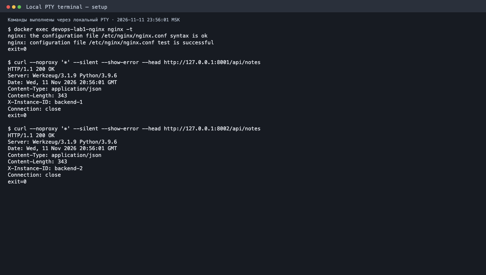

# Лабораторная 1 — Nginx

## Блокнот за Nginx

В лабораторной 0 блокнот работал через Flask. Теперь входной точкой стал Nginx: он отдаёт страницу, направляет `/api` к двум экземплярам Flask и должен сохранить доступность API при остановке одного из них. Именно отказ одного бэкенда стал главной проверкой этой работы.

На Mac я запустил две копии `backend/app.py` на портах 8001 и 8002. Обе обращаются к PostgreSQL лабораторной 0 на порту 55432. Nginx работает в контейнере `nginx:1.28-alpine` на портах 80 и 443 и достигает Flask на Mac через `host.docker.internal`. Переменная `INSTANCE_ID`, добавленная во Flask вместе с `APP_HOST`, позволяет узнать по заголовку `X-Instance-ID`, какая копия ответила. Операции с заметками и существующие записи в PostgreSQL при этом не менялись.

## Конфигурация Nginx

Конфигурация находится в [lab1-nginx/nginx.conf](../lab1-nginx/nginx.conf). В `upstream notebook_backends` указаны оба порта Flask. Nginx принимает HTTP на порту 80 и перенаправляет запрос на HTTPS; для локального HTTPS используется самоподписанный сертификат. Ниже — конфигурация целиком, чтобы настройки можно было проверить вместе, а не по вырванным строкам.

```nginx
events {
    worker_connections 1024;
}

http {
    include /etc/nginx/mime.types;
    default_type application/octet-stream;

    limit_req_zone $binary_remote_addr zone=api:10m rate=10r/s;

    upstream notebook_backends {
        server host.docker.internal:8001 max_fails=1 fail_timeout=5s;
        server host.docker.internal:8002 max_fails=1 fail_timeout=5s;
    }

    server {
        listen 80 default_server;
        server_name _;
        return 301 https://$host$request_uri;
    }

    server {
        listen 443 ssl default_server;
        server_name _;
        ssl_certificate /etc/nginx/certs/local.crt;
        ssl_certificate_key /etc/nginx/certs/local.key;
        return 404;
    }

    server {
        listen 443 ssl;
        server_name notes.test;
        ssl_certificate /etc/nginx/certs/local.crt;
        ssl_certificate_key /etc/nginx/certs/local.key;
        root /srv/frontend;
        index index.html;

        error_page 404 /404.html;
        location = /404.html {
            internal;
            alias /srv/pages/404.html;
        }

        location /static/ {
            alias /srv/frontend/;
        }

        location = /docs {
            return 301 /docs/;
        }
        location /docs/ {
            alias /srv/docs/;
            index index.html;
        }

        location = /admin {
            auth_basic "Admin area";
            auth_basic_user_file /etc/nginx/.htpasswd;
            alias /srv/pages/admin.html;
        }

        location /api {
            limit_req zone=api burst=5 nodelay;
            limit_req_status 429;
            proxy_pass http://notebook_backends;
            proxy_set_header Host $host;
            proxy_next_upstream error timeout http_502 http_503 http_504;
        }

        location / {
            try_files $uri $uri/ =404;
        }
    }

    server {
        listen 443 ssl;
        server_name other.test;
        ssl_certificate /etc/nginx/certs/local.crt;
        ssl_certificate_key /etc/nginx/certs/local.key;
        root /srv/other;
        index index.html;

        error_page 404 /404.html;
        location = /404.html {
            internal;
            alias /srv/pages/404.html;
        }

        location / {
            try_files $uri $uri/ =404;
        }
    }
}
```

После запуска я отдельно сверил конфигурацию через `nginx -t`:


Виртуальные хосты `notes.test` и `other.test` имеют разные корни, а неизвестному Host отвечает сервер по умолчанию с 404. Статику Nginx читает сам; `/api` проксирует в `upstream`. Для `/docs/` настроен `alias`, `/admin` требует Basic Authentication, а частые запросы к API получают 429. Отдельная страница 404 помогает отличить ответ этого сервера от стандартной страницы Nginx. Соответствие настроек и задач:

| Задача | Настройка |
| --- | --- |
| HTTPS и 301 | `listen 443 ssl`, локальный сертификат; сервер на 80 возвращает `301 https://$host$request_uri` |
| Разделение фронтенда и API | `root`/`alias` читают `frontend/` прямо в Nginx; `/api` проходит через `proxy_pass` |
| Балансировка и отказоустойчивость | `upstream` с портами 8001/8002 и `proxy_next_upstream`; Flask возвращает `X-Instance-ID` |
| Псевдоним каталога | `/docs/` использует `alias /srv/docs/` |
| Виртуальные хосты | `notes.test` и `other.test` имеют разные корни; неизвестный Host получает 404 |
| Ограничение запросов | `limit_req_zone` на IP, `limit_req` только для API, `limit_req_status 429` |
| Своя 404 | `error_page 404` показывает `pages/404.html` |
| Basic Authentication | `/admin` использует `auth_basic` и локальный файл `.htpasswd` |

Самоподписанные `local.crt` и `local.key`, пароль в `.env`, файл `.htpasswd` и рабочие PID/логи исключены из Git. Для команд с локальными доменами я использовал `curl --resolve`, не меняя `/etc/hosts`.

## Запуск и команды проверки

Полные команды создания сертификата и `htpasswd`, запуска и остановки есть в [README](../README.md). После старта двух Flask-процессов я проверил синтаксис Nginx и выполнил несколько запросов вручную, а затем запустил общий скрипт проверок:

```zsh
./lab1-nginx/start-backends.sh
docker exec devops-lab1-nginx nginx -t
curl --noproxy '*' -sSI --resolve notes.test:80:127.0.0.1 http://notes.test/
curl --noproxy '*' -skD - -o /dev/null --resolve notes.test:443:127.0.0.1 https://notes.test/api/notes
./lab1-nginx/check.sh
```

`curl -I` вернул `HTTP/1.1 301 Moved Permanently` и `Location: https://notes.test/`. Оба домена перенаправляют HTTP на HTTPS. Страница, JavaScript, CSS и `/docs/` через HTTPS вернули 200; `/admin` без пароля — 401. Запрос к точному пути `/api` дошёл до Flask и вернул 404 с заголовком `X-Instance-ID`: проксирование сработало, просто у блокнота нет такого эндпоинта.

Страница блокнота в Chrome открыта через `https://notes.test/`:


На снимке проверки от 11 ноября 2026 года прямые `HEAD /api/notes` на портах 8001 и 8002 вернули HTTP 200 с разными `X-Instance-ID`. Там же виден успешный `nginx -t`. [Полный вывод команд](evidence/lab1-audit-setup.txt):



## Проверка двух бэкендов и отказа одного из них

Пока работали обе копии Flask, шесть запросов распределились между `backend-2` и `backend-1` попеременно. Затем `check.sh` остановил только `backend-1`: все **4 из 4** запросов к API через Nginx получили HTTP 200 с `X-Instance-ID: backend-2`. Первый процесс после проверки был запущен снова. Для клиента падение половины бэкенда оказалось довольно скучным событием — блокнот продолжил отвечать.

Полный вывод успешного запуска `check.sh` (код завершения 0) сохраняет и остальные проверки:

```text
PASS: nginx -t
PASS: HTTP 301 -> https://notes.test/ and https://other.test/
PASS: HTTPS 200 with self-signed certificate (-k)
PASS: Nginx serves frontend HTML, CSS and JavaScript
PASS: API proxy 200 from backend-2; exact /api reaches Flask
PASS: Both backends served requests: backend-2 backend-1 backend-2 backend-1 backend-2 backend-1
PASS: backend-1 stopped; 4/4 API requests returned 200 from backend-2
backend-1 ready on port 8001 (PID 13187)
backend-2 already running on port 8002 (PID 11436)
PASS: backend-1 restored on port 8001
PASS: /docs alias 200
PASS: Virtual hosts isolated; unknown Host 404
PASS: /admin: 401 without password, 200 with htpasswd credentials
PASS: limit_req returned 429 on 28 of 40 rapid requests
PASS: Missing page: HTTP 404 with custom content
ALL CHECKS PASSED
```

На снимке повторного запуска `check.sh` 429 получен в 29 из 40 запросов. Текстовый вывод выше относится к другому успешному прогону, где ответов 429 было 28:


Скрипт проверен и на ошибке: при остановленном `devops-lab1-nginx` команда `./lab1-nginx/check.sh` завершилась с кодом **1** и сообщением `FAIL: nginx -t: ... container ... is not running`. После `docker start devops-lab1-nginx` страница снова ответила HTTP 200. Так видно, что успешный вывод скрипта не получается при неработающем Nginx.

После восстановления `backend-1` снова ответил на порту 8001. Ограничение частоты также сработало: в этом прогоне 28 из 40 быстрых запросов получили 429. Проверки `/admin`, двух виртуальных хостов, `/docs/` и собственной страницы 404 прошли с кодами, указанными в выводе выше.

Обе копии Flask вернули одинаковый список заметок с ID `[5, 1]`. SQL-запрос к PostgreSQL `SELECT id FROM notes ORDER BY id;` вернул `1` и `5`: балансировка меняет обработчик запроса, но обе копии работают с одной базой. Исходные записи не удалялись; контейнер и том БД не пересоздавались.
