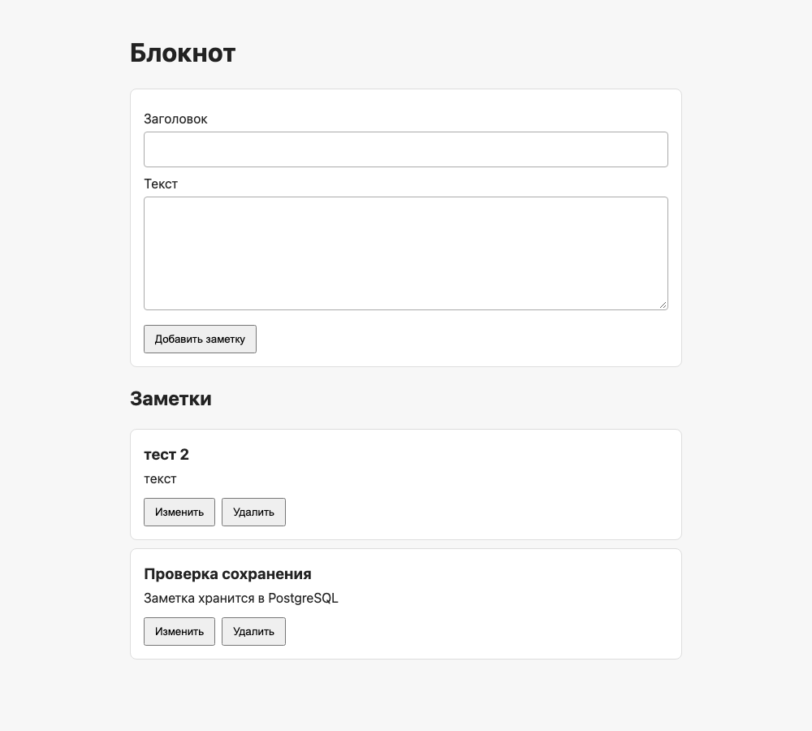
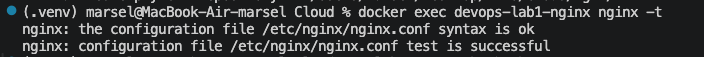
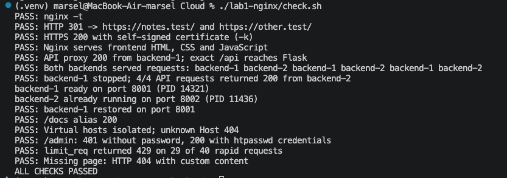

# Лабораторная 1 — Nginx

## Цель и схема

Сделать Nginx точкой входа для блокнота лабораторной 0, раздавать фронтенд отдельно от Flask и сохранить доступность API при падении одной из двух копий бэкенда.

На Mac работают две копии того же `backend/app.py`: порты 8001 и 8002, одна PostgreSQL лабораторной 0 на 55432. Nginx работает в официальном контейнере `nginx:1.28-alpine` на 80/443 и обращается к Mac через `host.docker.internal`. Flask изменён только для переменных `APP_HOST` и `INSTANCE_ID`; операции с заметками не менялись. Существующие заметки остались в PostgreSQL.

## Конфигурация Nginx

Файл: [lab1-nginx/nginx.conf](../lab1-nginx/nginx.conf).

```nginx
events {
    worker_connections 1024;
}

http {
    include /etc/nginx/mime.types;
    default_type application/octet-stream;

    limit_req_zone $binary_remote_addr zone=api:10m rate=10r/s;

    upstream notebook_backends {
        server host.docker.internal:8001 max_fails=1 fail_timeout=5s;
        server host.docker.internal:8002 max_fails=1 fail_timeout=5s;
    }

    server {
        listen 80 default_server;
        server_name _;
        return 301 https://$host$request_uri;
    }

    server {
        listen 443 ssl default_server;
        server_name _;
        ssl_certificate /etc/nginx/certs/local.crt;
        ssl_certificate_key /etc/nginx/certs/local.key;
        return 404;
    }

    server {
        listen 443 ssl;
        server_name notes.test;
        ssl_certificate /etc/nginx/certs/local.crt;
        ssl_certificate_key /etc/nginx/certs/local.key;
        root /srv/frontend;
        index index.html;

        error_page 404 /404.html;
        location = /404.html {
            internal;
            alias /srv/pages/404.html;
        }

        location /static/ {
            alias /srv/frontend/;
        }

        location = /docs {
            return 301 /docs/;
        }
        location /docs/ {
            alias /srv/docs/;
            index index.html;
        }

        location = /admin {
            auth_basic "Admin area";
            auth_basic_user_file /etc/nginx/.htpasswd;
            alias /srv/pages/admin.html;
        }

        location /api {
            limit_req zone=api burst=5 nodelay;
            limit_req_status 429;
            proxy_pass http://notebook_backends;
            proxy_set_header Host $host;
            proxy_next_upstream error timeout http_502 http_503 http_504;
        }

        location / {
            try_files $uri $uri/ =404;
        }
    }

    server {
        listen 443 ssl;
        server_name other.test;
        ssl_certificate /etc/nginx/certs/local.crt;
        ssl_certificate_key /etc/nginx/certs/local.key;
        root /srv/other;
        index index.html;

        error_page 404 /404.html;
        location = /404.html {
            internal;
            alias /srv/pages/404.html;
        }

        location / {
            try_files $uri $uri/ =404;
        }
    }
}
```


| Обязательное требование | Настройка |
| --- | --- |
| HTTPS и 301 | `listen 443 ssl`, локальный сертификат; сервер на 80 возвращает `301 https://$host$request_uri` |
| Разделение фронтенда и API | `root`/`alias` читают `frontend/` прямо в Nginx; `/api` проходит через `proxy_pass` |
| Балансировка и отказоустойчивость | `upstream` с портами 8001/8002 и `proxy_next_upstream`; Flask возвращает `X-Instance-ID` |
| Псевдоним каталога | `/docs/` использует `alias /srv/docs/` |
| Виртуальные хосты | `notes.test` и `other.test` имеют разные корни; неизвестный Host получает 404 |
| Ограничение запросов | `limit_req_zone` на IP, `limit_req` только для API, `limit_req_status 429` |
| Своя 404 | `error_page 404` показывает `pages/404.html` |
| Basic Authentication | `/admin` использует `auth_basic` и локальный файл `.htpasswd` |

Самоподписанные `local.crt` и `local.key`, пароль в `.env`, файл `.htpasswd` и рабочие PID/логи исключены из Git. Системный `/etc/hosts` не изменялся; проверки используют `curl --resolve`. Для просмотра в браузере локальные имена можно добавить вручную.

## Запуск и команды проверки

Полные команды первого запуска, создания сертификата и `htpasswd`, повторного запуска и остановки находятся в [README](../README.md). Для проверки использованы:

```zsh
./lab1-nginx/start-backends.sh
docker exec devops-lab1-nginx nginx -t
curl --noproxy '*' -sSI --resolve notes.test:80:127.0.0.1 http://notes.test/
curl --noproxy '*' -skD - -o /dev/null --resolve notes.test:443:127.0.0.1 https://notes.test/api/notes
./lab1-nginx/check.sh
```

`curl -I` вернул `HTTP/1.1 301 Moved Permanently` и `Location: https://notes.test/`. Оба домена перенаправляют HTTP на HTTPS; HTTPS-страница, JavaScript, CSS и `/docs/` вернули 200, `/admin` без пароля — 401. Точный путь `/api` дошёл до Flask: он вернул 404 с заголовком `X-Instance-ID`, поскольку эндпоинта `/api` у блокнота нет.

## Настоящий вывод check.sh

Скрипт завершился с кодом 0. Он автоматически останавливал только `backend-1`, проверял четыре ответа от `backend-2` и восстановил `backend-1`.

```text
PASS: nginx -t
PASS: HTTP 301 -> https://notes.test/ and https://other.test/
PASS: HTTPS 200 with self-signed certificate (-k)
PASS: Nginx serves frontend HTML, CSS and JavaScript
PASS: API proxy 200 from backend-2; exact /api reaches Flask
PASS: Both backends served requests: backend-2 backend-1 backend-2 backend-1 backend-2 backend-1
PASS: backend-1 stopped; 4/4 API requests returned 200 from backend-2
backend-1 ready on port 8001 (PID 13187)
backend-2 already running on port 8002 (PID 11436)
PASS: backend-1 restored on port 8001
PASS: /docs alias 200
PASS: Virtual hosts isolated; unknown Host 404
PASS: /admin: 401 without password, 200 with htpasswd credentials
PASS: limit_req returned 429 on 28 of 40 rapid requests
PASS: Missing page: HTTP 404 with custom content
ALL CHECKS PASSED
```

Отрицательная проверка скрипта: при остановленном `devops-lab1-nginx` команда `./lab1-nginx/check.sh` завершилась с кодом **1** и сообщением `FAIL: nginx -t: ... container ... is not running`. После `docker start devops-lab1-nginx` страница снова ответила HTTP 200.


Серия запросов показала оба идентификатора: `backend-2`, `backend-1`, `backend-2`, `backend-1`, `backend-2`, `backend-1`. После остановки первого экземпляра **4 из 4** запросов через Nginx вернули HTTP 200 с `X-Instance-ID: backend-2`; затем первый снова ответил на порту 8001. Это реальная проверка главного требования лабораторной.

Обе копии Flask вернули одинаковый список заметок с ID `[5, 1]`. SQL-запрос к PostgreSQL `SELECT id FROM notes ORDER BY id;` вернул `1` и `5`. Исходные записи не удалялись; контейнер и том БД не пересоздавались.

## Скриншоты

Реальный снимок страницы блокнота, открытой в Chrome через `https://notes.test/` и Nginx:



Проверка синтаксиса конфигурации командой `docker exec devops-lab1-nginx nginx -t`:



Повторный запуск `./lab1-nginx/check.sh` в терминале. На этом снимке 429 получен в 29 из 40 запросов; текстовый вывод выше относится к другому успешному прогону, где таких ответов было 28:


