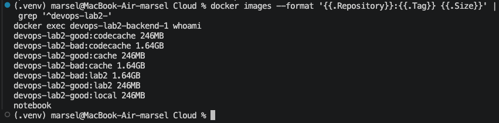
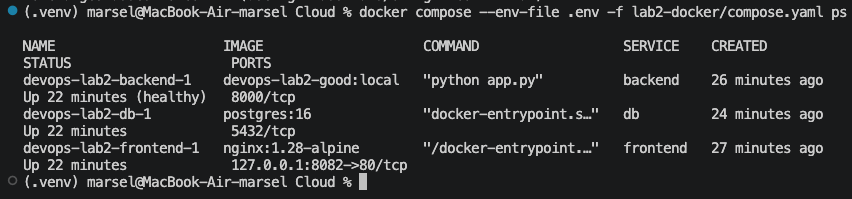
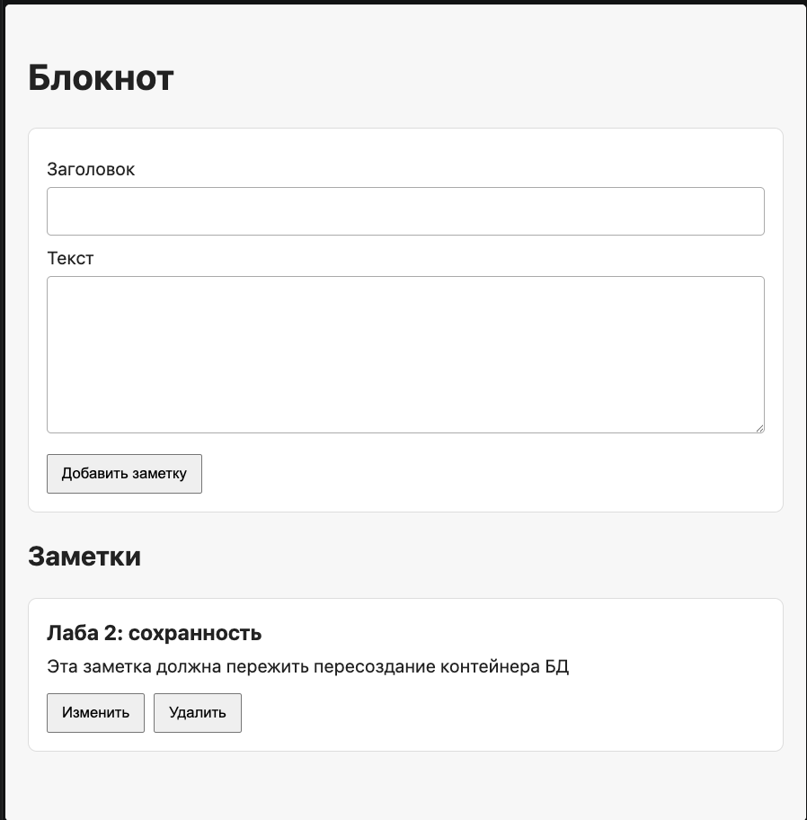
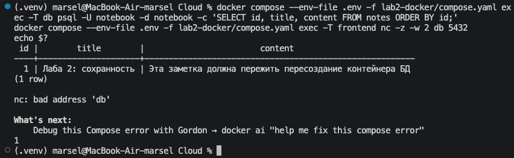

# Лабораторная 2 — Docker

> Размеры и время сборки ниже измерены для версии `lab2-done`. Позже, при работе над лабораторной 3, базовый образ в `Dockerfile.good` обновился после сканирования CRITICAL CVE. Новые результаты Trivy — в [отчёте лабораторной 3](lab3.md).

## Блокнот переезжает в контейнеры

Я собрал для Flask-бэкенда два образа: первый намеренно неудобный, второй с исправленными практиками. Сравнил размер, пользователя процесса и время пересборки после изменения строки кода. Затем поднял весь блокнот одной командой Docker Compose. Работа велась на macOS с Docker Desktop; `uname -m` и архитектура образов — `arm64`.

В Compose сервис `frontend` — Nginx со статикой из общей папки `frontend/`, `backend` — Flask из `backend/app.py`, `db` — PostgreSQL. Блокнот открывается по `http://127.0.0.1:8082/`; лабораторная 1 продолжает работать отдельно на портах 80/443.

## Два Dockerfile

### Плохой: `lab2-docker/Dockerfile.bad`

В первом варианте я взял полный `python:3.11`, скопировал код до установки зависимостей и оставил запуск от root. Поэтому образ заведомо тяжёлый, а изменение `app.py` заставляет снова выполнять `pip install`. Проверки здоровья в нём тоже нет.

```dockerfile
# BAD: the full Python image is much larger than the slim runtime image.
FROM python:3.11

WORKDIR /app

# BAD: changing app.py invalidates the following dependency-install layer.
COPY backend/ /app/
RUN pip install --no-cache-dir -r requirements.txt

# BAD: no USER directive, so the process runs as root.
EXPOSE 8000
CMD ["python", "app.py"]
```

### Хороший: `lab2-docker/Dockerfile.good`

Во втором варианте зависимости устанавливаются в этапе `builder`, а итоговый образ получает только runtime и нужные файлы. `requirements.txt` копируется до `app.py`: правка приложения не должна сбрасывать кеш установки пакетов. Отдельный пользователь `notebook` ограничивает права процесса, а `HEALTHCHECK` проверяет существующий API без дополнительной библиотеки.

```dockerfile
FROM python:3.11.14-slim-bookworm AS builder

WORKDIR /build
COPY backend/requirements.txt .
RUN pip install --no-cache-dir --prefix=/install -r requirements.txt

FROM python:3.11.14-slim-bookworm

RUN groupadd --system notebook && useradd --system --gid notebook --home-dir /app notebook
WORKDIR /app
COPY --from=builder /install /usr/local
COPY backend/app.py .

ENV PYTHONDONTWRITEBYTECODE=1 PYTHONUNBUFFERED=1
USER notebook
EXPOSE 8000
HEALTHCHECK --interval=10s --timeout=3s --start-period=20s --retries=3 \
    CMD python -c "import urllib.request; urllib.request.urlopen('http://127.0.0.1:8000/api/notes', timeout=2)" || exit 1
CMD ["python", "app.py"]
```

Корневой `.dockerignore` исключает из контекста сборки `.git`, `.venv`, `.env*`, ключи и сертификаты, локальные данные БД, `__pycache__`, документы заданий, отчёты, `frontend/` и файлы лабораторной 1. Он действует для обоих образов, поэтому я не записываю его отсутствие в список недостатков первого Dockerfile.

| Плохая практика | Как исправлено |
| --- | --- |
| Полный `python:3.11` как база | В итоговом образе используется более лёгкий `python:3.11.14-slim-bookworm` с зафиксированной версией |
| Процесс Flask работает от root | Создан отдельный пользователь `notebook`; `USER notebook` |
| `COPY backend/` стоит перед установкой зависимостей | Сначала копируется `requirements.txt` и ставятся зависимости, затем копируется `app.py`; изменение кода сохраняет слой `pip install` в кеше |
| Нет проверки работоспособности контейнера | `HEALTHCHECK` вызывает существующий `GET /api/notes` стандартной библиотекой Python |

Чтобы бэкенд дождался PostgreSQL при первом старте Compose, в `backend/app.py` добавлено ожидание: Compose задаёт `DB_STARTUP_RETRIES=30`, а для запусков лабораторных 0 и 1 остаётся значение по умолчанию `1`. API и поведение заметок от этого не изменились.

## Сборка и сравнение образов

Сначала собрал оба варианта и посмотрел их размеры:

```zsh
docker build -f lab2-docker/Dockerfile.bad -t devops-lab2-bad:lab2 .
docker build -f lab2-docker/Dockerfile.good -t devops-lab2-good:lab2 .
docker images --format '{{.Repository}}:{{.Tag}} {{.Size}}' | rg '^devops-lab2-(bad|good):lab2 '
```

Вывод `docker images` после итоговой сборки:

```text
devops-lab2-bad:lab2 1.64GB
devops-lab2-good:lab2 246MB
```

На снимке рядом с размерами виден и ответ `whoami` для хорошего backend — `notebook`:



`docker image inspect` уточнил размеры: плохой — **1 644 096 506 байт**, хороший — **246 068 410 байт**. Оба образа имеют архитектуру `arm64`. Хороший примерно в 6,7 раза меньше: полная база Python тянет больше системных пакетов, а двухэтапная сборка оставляет в конечном образе только необходимые зависимости и приложение. Здесь «плохой» Dockerfile честно оправдал своё название.

Оба образа запускались во временных контейнерах сети `devops-lab2_data` с локальным `.env`, `DB_HOST=db`, `DB_PORT=5432`, `APP_HOST=0.0.0.0` и `APP_PORT=8000`. Команда `docker exec <container> whoami` и запрос к API внутри каждого контейнера дали следующие результаты:

```text
bad user=root
bad api=200
bad health=not configured
good user=notebook
good api=200
good health=starting
```

Статус `starting` у хорошего образа снят сразу после запуска временного контейнера, до первого успешного healthcheck. Позже backend в Compose получил `healthy`. Временные контейнеры после сравнения остановлены.

Повторная команда для постоянно работающего хорошего образа в Compose:

```zsh
docker exec devops-lab2-backend-1 whoami
docker inspect devops-lab2-backend-1 --format '{{.State.Health.Status}}'
```

Эта проверка дала `notebook`, затем `healthy`: итоговый контейнер работает от отдельного пользователя и отвечает на проверку здоровья.

### Время повторной сборки после правки строки кода

Для сравнения кеша я временно изменил **одну строку кода** в `backend/app.py`: в вызове `Flask(...)` заменил двойные кавычки вокруг путей на одинарные. Поведение приложения от этого не изменилось. Оба образа пересобрал командой `/usr/bin/time -p docker build --progress=plain -f lab2-docker/Dockerfile.<variant> -t devops-lab2-<variant>:codecache .`. После опыта файл вернул к исходным байтам; SHA-256 до и после одинаковый — `81e64f4a42e798f8fe35b15786e438dab7115fbd5ab97657cf0d49f49ee6a4cf`.

| Повторная сборка | `real` | Слой установки зависимостей |
| --- | ---: | --- |
| Плохой образ | 8,23 с | `RUN pip install ...` выполнен снова, слой занял 6,5 с |
| Хороший образ | 0,35 с | `RUN pip install ...` — `CACHED` |

Фрагменты фактического вывода:

```text
bad  #8 [4/4] RUN pip install --no-cache-dir -r requirements.txt
bad  #8 DONE 6.5s
bad  real 8.23
good #6 [builder 4/4] RUN pip install --no-cache-dir --prefix=/install -r requirements.txt
good #6 CACHED
good real 0.35
```

Разница объясняется порядком слоёв. В плохом образе изменение `app.py` меняет слой `COPY backend/`, и Docker заново выполняет установку зависимостей: 8,23 с против 0,35 с. В хорошем образе этот слой зависит только от `requirements.txt` и остаётся в кеше.

## Docker Compose

`lab2-docker/compose.yaml`:

```yaml
name: devops-lab2

services:
  frontend:
    image: nginx:1.28-alpine
    ports:
      - "127.0.0.1:8082:80"
    volumes:
      - ../frontend:/usr/share/nginx/html:ro
      - ./nginx.conf:/etc/nginx/conf.d/default.conf:ro
    depends_on:
      - backend
    networks:
      - web

  backend:
    build:
      context: ..
      dockerfile: lab2-docker/Dockerfile.good
    image: devops-lab2-good:local
    environment:
      POSTGRES_USER: ${POSTGRES_USER}
      POSTGRES_DB: ${POSTGRES_DB}
      POSTGRES_PASSWORD: ${POSTGRES_PASSWORD}
      DB_HOST: db
      DB_PORT: "5432"
      DB_STARTUP_RETRIES: "30"
      APP_HOST: 0.0.0.0
      APP_PORT: "8000"
    depends_on:
      - db
    networks:
      - web
      - data

  db:
    image: postgres:16
    environment:
      POSTGRES_USER: ${POSTGRES_USER}
      POSTGRES_DB: ${POSTGRES_DB}
      POSTGRES_PASSWORD: ${POSTGRES_PASSWORD}
    volumes:
      - notes_data:/var/lib/postgresql/data
    networks:
      - data

networks:
  web:
  data:

volumes:
  notes_data:
```

`lab2-docker/nginx.conf` отдаёт файлы `frontend/`, а `/api` направляет на `backend:8000`. В корне проекта с локальным `.env` все три сервиса запускаются одной командой:

```zsh
docker compose --env-file .env -f lab2-docker/compose.yaml up -d --build
docker compose --env-file .env -f lab2-docker/compose.yaml ps
```

После первого старта я дождался готовности PostgreSQL и статуса `healthy` у backend. Затем остановил и снова запустил три сервиса; Compose показал:

```text
NAME                     IMAGE                    SERVICE    STATUS                   PORTS
devops-lab2-backend-1    devops-lab2-good:local   backend    Up 3 minutes (healthy)   8000/tcp
devops-lab2-db-1         postgres:16              db         Up 3 minutes             5432/tcp
devops-lab2-frontend-1   nginx:1.28-alpine        frontend   Up 3 minutes             127.0.0.1:8082->80/tcp
```

Все три сервиса в Compose после запуска:



По адресу `http://127.0.0.1:8082/` страница и `GET /api/notes` получили HTTP **200**. `/static/style.css` и `/static/app.js` тоже ответили HTTP **200** с типами `text/css` и `application/javascript`: файлы отдаёт Nginx. Через этот же адрес я создал, прочитал, изменил и удалил временную заметку: `POST 201`, `GET 200`, `PUT 200`, `DELETE 204`, затем `GET 200`. Постоянная проверочная заметка осталась в базе.

Так блокнот выглядел в браузере с сохранённой заметкой:



## Сохранность данных в именованном томе

Контейнер БД можно заменить, но записи должны пережить эту замену благодаря именованному тому. Я создал через `POST http://127.0.0.1:8082/api/notes` заметку `id=1` с заголовком `Лаба 2: сохранность`; SQL-запрос показывал её до пересоздания контейнера. Затем выполнил:

```zsh
docker compose --env-file .env -f lab2-docker/compose.yaml stop db
docker rm devops-lab2-db-1
docker compose --env-file .env -f lab2-docker/compose.yaml up -d db
docker compose --env-file .env -f lab2-docker/compose.yaml exec -T db \
  psql -U notebook -d notebook -c 'SELECT id, title, content FROM notes ORDER BY id;'
```

ID контейнера БД изменился с `e5d0b6543aaa…` на `e3afa41b4313…`, а именованный том остался `devops-lab2_notes_data`. После пересоздания `pg_isready` ответил `accepting connections`, SQL вернул:

```text
 id |        title        |                        content
----+---------------------+--------------------------------------------------------
  1 | Лаба 2: сохранность | Эта заметка должна пережить пересоздание контейнера БД
(1 row)
```

Через Nginx `GET /api/notes` также вернул эту заметку с HTTP 200. После дополнительного `docker compose stop` и `up -d` данные снова читались. Смена контейнера оказалась для записи незаметной: она осталась в `devops-lab2_notes_data`. Команда `docker compose down -v` не выполнялась.

## Сетевая изоляция

Чтобы frontend не мог обратиться к PostgreSQL напрямую, я развёл сервисы по сетям `web` и `data`. Backend подключён к обеим: он принимает запросы от Nginx и общается с БД. Фактические подключения контейнеров:

```text
frontend networks=devops-lab2_web
backend networks=devops-lab2_data devops-lab2_web
db networks=devops-lab2_data
```

Команда из frontend `wget -qO- http://backend:8000/api/notes` вернула JSON со строкой `id=1`. Из backend прямой SQL-запрос через `psycopg2` вернул `('notebook', 5432)`, то есть соединение установлено именно с PostgreSQL. Прямые попытки из frontend:

```text
nc -z -w 2 db 5432          → nc: bad address 'db'; код выхода 1
nc -z -w 2 172.20.0.2 5432 → код выхода 1
```

Адрес `172.20.0.2` был получен через `docker inspect` и на момент опыта принадлежал БД в `devops-lab2_data`. Попытка по IP тоже завершилась ошибкой, так что результат не сводится к отсутствию DNS-имени `db`: у frontend нет прямого сетевого маршрута к базе.

На снимке рядом показаны SQL-запрос после пересоздания БД и ошибка подключения frontend к `db:5432` по имени. Дополнительная попытка по IP приведена в текстовом выводе выше.



## Сохранение предыдущих лабораторных

После запуска Compose проверены `docker exec devops-lab1-nginx nginx -t`, HTTPS-страница лабораторной 1 и её `/api/notes`: конфигурация валидна, оба запроса дали HTTP 200. Отдельные контейнеры лабораторной 0 и 1 и их данные не удалялись.

## Вывод

Хороший образ оказался меньше и быстрее пересобирался после правки кода: 246 MB против 1,64 GB и 0,35 с против 8,23 с. В Compose все три сервиса работали вместе, но frontend не имел прямого доступа к БД. После удаления и пересоздания контейнера PostgreSQL заметка `id=1` осталась и читалась через API. Плюс контейнер бэкенда запущен от `notebook` и имеет статус `healthy` — это подтверждено командами и снимками выше.

Нагрузку и восстановление стека я исследовал отдельно в [лабораторной 2★](lab2-bonus.md).
