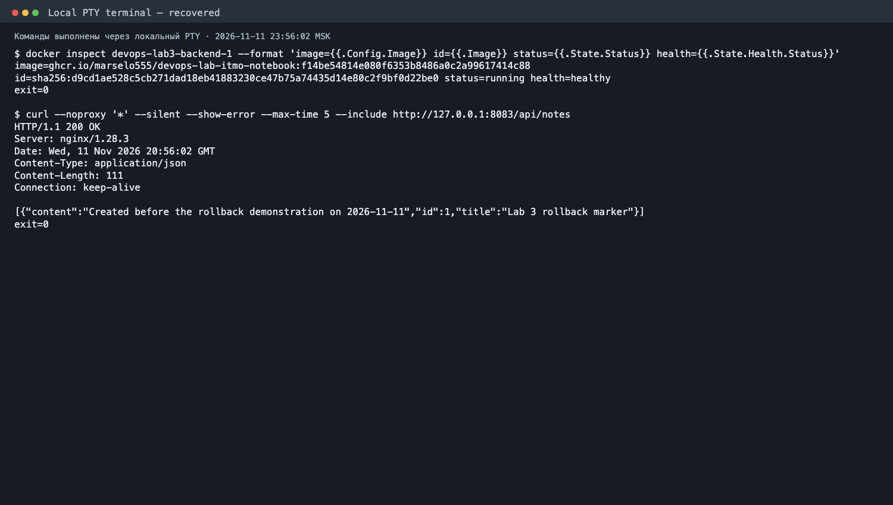

# Лабораторная 3★ — откат релиза

Я проверил откат на отдельном Compose-проекте `devops-lab3` на порту `8083`: сначала зафиксировал рабочий релиз и запись в PostgreSQL, затем развернул заведомо неисправный образ и одной командой вернул прежнюю версию. Важно было получить снова работающий API и сохранить заметку. Основной CI/CD описан в [отчёте лабораторной 3](lab3.md).

## Рабочая версия перед экспериментом

Основной workflow публикует бэкенд в GHCR с тегом полного SHA коммита. Это даёт для отката точный адрес предыдущего образа. До эксперимента на Mac работал `ghcr.io/marselo555/devops-lab-itmo-notebook:2f8ca801a2c39e1ff72e9c4e4fae15137baa8ea6` (`sha256:d9cd1ae528c5cb271dad18eb41883230ce47b75a74435d14e80c2f9bf0d22be0`). Образ уже был доступен локально, имел архитектуру `arm64`, backend был `healthy`.

Я добавил контрольную заметку с ID `1` и заголовком `Lab 3 rollback marker`. `GET http://127.0.0.1:8083/api/notes` вернул HTTP 200 и эту заметку; `psql` показал ту же строку в PostgreSQL с томом `devops-lab3_notes_data`. Это точка отсчёта: после отката должны совпасть и ответ API, и запись в базе. Команды сохранены в [протоколе до эксперимента](evidence/lab3-bonus-before.txt).


## Подготовка неисправной версии и отката

Для неисправного релиза я создал отдельный [Dockerfile](../lab2-docker/Dockerfile.rollback-broken): он наследует рабочий образ, но заменяет команду запуска на намеренное завершение с ошибкой. Код блокнота остался общим для лабораторных. Локальный `devops-lab3-broken:demo-20261111` получил image ID `sha256:a9adacfbe7be87a410196880dd8d783648a52c29f42c442487e1c60fbf5e8b4e`. Основной workflow и его security gate при этом работали как прежде.

Откат оформлен в [скрипте](../lab2-docker/rollback.py). Он принимает полный GHCR-тег по SHA, проверяет наличие образа локально, пересоздаёт backend и frontend проекта `devops-lab3` с `--no-build --pull never`, сверяет image ID и ждёт HTTP 200 от `/api/notes`. PostgreSQL и его том остаются на месте. Таймер в одном процессе Python измеряет интервал от запуска команды до первого успешного ответа API.

## Сломанный релиз

Неисправный образ собран локально командой:

```zsh
docker build -f lab2-docker/Dockerfile.rollback-broken \
  -t devops-lab3-broken:demo-20261111 .
```

Убедившись, что прежний рабочий образ есть на Mac, я передал Compose новый `BACKEND_IMAGE` и заменил backend проекта 3 на `devops-lab3-broken:demo-20261111`. Конфигурацию `compose.yaml` для этого менять не потребовалось.

```zsh
BACKEND_IMAGE=devops-lab3-broken:demo-20261111 FRONTEND_PORT=8083 \
  docker compose -p devops-lab3 --env-file .env \
  -f lab2-docker/compose.yaml up -d --no-deps --no-build \
  --pull never --force-recreate backend
```

Проверка показала новый image ID `sha256:a9adacfbe7be87a410196880dd8d783648a52c29f42c442487e1c60fbf5e8b4e`. Контейнер завершился с кодом `1`; в журнале осталась строка `Intentional lab 3 rollback demo failure`. За 5 секунд запрос к API не получил ответа (`curl` завершился с кодом `28`, HTTP `000`). В браузере Nginx показал `502 Bad Gateway`: сам он был жив, а обращаться ему уже было не к кому. Команды и состояния — в [протоколе сломанного релиза](evidence/lab3-bonus-broken.txt).


## Возврат к рабочему образу

После подтверждённого сбоя я запустил откат одной командой с точным тегом рабочей версии:

```zsh
python3 lab2-docker/rollback.py \
  ghcr.io/marselo555/devops-lab-itmo-notebook:2f8ca801a2c39e1ff72e9c4e4fae15137baa8ea6
```

Скрипт вернул backend на `sha256:d9cd1ae528c5cb271dad18eb41883230ce47b75a74435d14e80c2f9bf0d22be0` и пересоздал frontend, чтобы Nginx заново нашёл контейнер бэкенда. Команда завершилась после успешного запроса:

```text
Recovery time: 1.244 seconds
Running backend image: ghcr.io/marselo555/devops-lab-itmo-notebook:2f8ca801a2c39e1ff72e9c4e4fae15137baa8ea6
GET /api/notes: HTTP 200
[{"content":"Created before the rollback demonstration on 2026-11-11","id":1,"title":"Lab 3 rollback marker"}]
```

Время отката — **1,244 секунды** от запуска команды до первого HTTP 200, включая пересоздание двух контейнеров. [Полный вывод](evidence/lab3-bonus-rollback.txt) сохранён. Первый способ измерения оказался ошибочным: два процесса системного Python 3.9 на этом Mac дали несопоставимые значения монотонных часов и отрицательное время. [Первый протокол](evidence/lab3-bonus-rollback-invalid-timing.txt) оставлен отдельно; его число не использовано как результат. После исправления таймера я повторил всю последовательность «сломанный образ → откат → HTTP 200». Метрика 1,244 секунды относится именно к повторному опыту.

## Контроль текущего восстановленного состояния

Позже, 11 ноября 2026 года в 23:54 МСК, я отдельно проверил состояние контейнера **без нового сбоя и отката**. Текущий тег — `ghcr.io/marselo555/devops-lab-itmo-notebook:f14be54814e080f6353b8486a0c2a99617414c88`, image ID — `sha256:d9cd1ae528c5cb271dad18eb41883230ce47b75a74435d14e80c2f9bf0d22be0`, статус — `healthy`. `curl -i http://127.0.0.1:8083/api/notes` вернул HTTP 200 и контрольную заметку. Тег отличается от использованного в историческом откате, хотя image ID совпадает. [Протокол контрольной проверки](evidence/lab3-bonus-audit-current.txt):



Снимок показывает текущее состояние и ответ API; ход отката и время 1,244 с зафиксированы в протоколе самого эксперимента выше.

## Сохранность данных и итог

Непосредственно после отката отдельный `curl` вернул HTTP 200 и контрольную заметку. Запрос `SELECT id, title, content FROM notes ORDER BY id` через `psql` показал ту же строку с ID `1`; PostgreSQL оставался подключённым к тому `devops-lab3_notes_data`. В протоколе того момента бэкенд работал с исходным GHCR-тегом и имел статус `healthy`, frontend и база были запущены. Эти проверки записаны в [выводе после восстановления](evidence/lab3-bonus-after.txt).


Снимки страницы до и после отката побайтно совпадают: заметка выглядела одинаково. Восстановление подтверждают команды, смена image ID и HTTP 200 в протоколах опыта. Более поздний снимок текущего состояния не выдаётся за снимок самого отката.

Эксперимент прошёл всю цепочку: рабочая версия → сломанный релиз → откат по известному SHA → восстановленный API. На повторном опыте это заняло 1,244 секунды. Образ предыдущей версии был на Mac ещё до сбоя, а PostgreSQL не пересоздавался, поэтому контрольная заметка сохранилась. Бэкенд успел «умереть» и вернуться, не утащив за собой данные.
