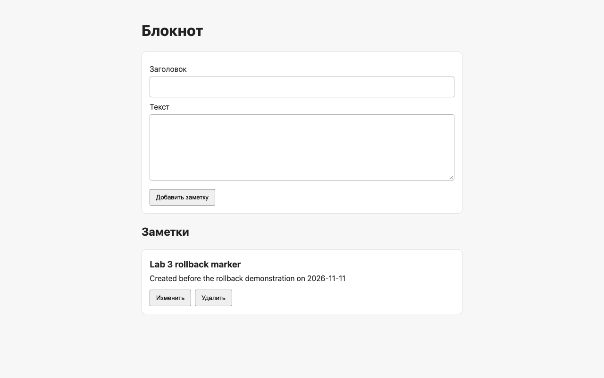
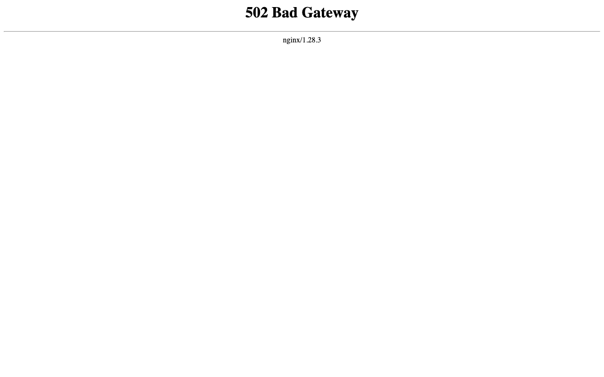

# Лабораторная 3★ — откат релиза

Цель задания — показать, что после развёртывания неисправного образа блокнота можно одной командой вернуть предыдущую рабочую версию. При этом записи PostgreSQL должны остаться на месте. Эксперимент относится только к Compose-проекту `devops-lab3` на порту `8083`; обычный CI/CD и остальные лабораторные не меняются.

## Рабочая версия перед экспериментом

Основной workflow публикует бэкенд в GHCR с тегом полного SHA коммита. Поэтому для отката можно указать конкретный образ, а не полагаться на `latest`. Перед экспериментом на Mac работал образ `ghcr.io/marselo555/devops-lab-itmo-notebook:2f8ca801a2c39e1ff72e9c4e4fae15137baa8ea6` (`sha256:d9cd1ae528c5cb271dad18eb41883230ce47b75a74435d14e80c2f9bf0d22be0`). Он уже был доступен локально, имел архитектуру `arm64`, а контейнер бэкенда находился в состоянии `healthy`.

Я добавил контрольную заметку с ID `1` и заголовком `Lab 3 rollback marker`. После этого `GET http://127.0.0.1:8083/api/notes` вернул HTTP 200 и эту заметку. Запрос через `psql` показал ту же запись в PostgreSQL, подключённом к тому `devops-lab3_notes_data`. Полный вывод команд сохранён в [доказательствах до эксперимента](evidence/lab3-bonus-before.txt).



## Подготовка неисправной версии и отката

Для проверки создан отдельный [Dockerfile](../lab2-docker/Dockerfile.rollback-broken), который наследует рабочий образ и заменяет только команду запуска на намеренное завершение процесса с ошибкой. Исходный код блокнота остаётся общим для всех лабораторных. Локальный образ `devops-lab3-broken:demo-20261111` собран с образом ID `sha256:a9adacfbe7be87a410196880dd8d783648a52c29f42c442487e1c60fbf5e8b4e`. Эта версия предназначена только для демонстрации; security gate основного workflow не отключался.

Команда отката подготовлена в [скрипте](../lab2-docker/rollback.py). Скрипт принимает полный GHCR-тег по SHA, убеждается, что образ есть локально, пересоздаёт только бэкенд и frontend проекта `devops-lab3` с `--no-build --pull never`, сверяет ID запущенного образа с выбранным и ждёт успешного ответа `/api/notes`. Базу данных он не пересоздаёт и том не удаляет. Время измеряется от запуска команды отката до первого HTTP 200 с помощью монотонных часов в одном процессе Python.

## Сломанный релиз

Образ я собрал локально, не отправляя его в GHCR и не меняя основной workflow:

```zsh
docker build -f lab2-docker/Dockerfile.rollback-broken \
  -t devops-lab3-broken:demo-20261111 .
```

После проверки, что рабочий образ есть на Mac, я временно заменил им только бэкенд проекта 3. Для этого Compose получил новый `BACKEND_IMAGE` через переменную окружения; файл `compose.yaml` редактировать не пришлось.

```zsh
BACKEND_IMAGE=devops-lab3-broken:demo-20261111 FRONTEND_PORT=8083 \
  docker compose -p devops-lab3 --env-file .env \
  -f lab2-docker/compose.yaml up -d --no-deps --no-build \
  --pull never --force-recreate backend
```

Проверка показала именно новый image ID `sha256:a9adacfbe7be87a410196880dd8d783648a52c29f42c442487e1c60fbf5e8b4e`. Контейнер завершился с кодом `1`, а в его журнале появилась строка `Intentional lab 3 rollback demo failure`. Запрос к API за 5 секунд не получил ответа (`curl` завершился с кодом `28`, HTTP `000`). В браузере Nginx показал `502 Bad Gateway`: он остался запущенным, но бэкенд уже не обслуживал запросы. Реальные команды, состояния и журнал находятся в [выводе сломанного релиза](evidence/lab3-bonus-broken.txt).



## Возврат к рабочему образу

Откат был одним запуском скрипта с точным тегом предыдущей рабочей версии:

```zsh
python3 lab2-docker/rollback.py \
  ghcr.io/marselo555/devops-lab-itmo-notebook:2f8ca801a2c39e1ff72e9c4e4fae15137baa8ea6
```

Скрипт вернул бэкенд на образ `sha256:d9cd1ae528c5cb271dad18eb41883230ce47b75a74435d14e80c2f9bf0d22be0`, затем пересоздал frontend. Так Nginx заново нашёл адрес контейнера бэкенда. Команда завершилась только после успешного запроса:

```text
Recovery time: 1.244 seconds
Running backend image: ghcr.io/marselo555/devops-lab-itmo-notebook:2f8ca801a2c39e1ff72e9c4e4fae15137baa8ea6
GET /api/notes: HTTP 200
[{"content":"Created before the rollback demonstration on 2026-11-11","id":1,"title":"Lab 3 rollback marker"}]
```

Время `1.244` с измерено от запуска отката до первого успешного ответа API, включая пересоздание двух контейнеров и ожидание HTTP 200. Полный вывод команды сохранён [отдельно](evidence/lab3-bonus-rollback.txt). При первом выполнении я обнаружил ошибку в способе измерения: два процесса системного Python 3.9 на этом Mac дали несопоставимые значения монотонных часов. Этот [первый вывод](evidence/lab3-bonus-rollback-invalid-timing.txt) оставлен для проверки, но его отрицательное время не используется как результат. После исправления таймера я повторил сценарий «сломанный образ → откат → HTTP 200»; указанная метрика относится к повторному прогону.

## Сохранность данных и итог

После отката отдельный `curl` снова вернул HTTP 200 и контрольную заметку. Запрос `SELECT id, title, content FROM notes ORDER BY id` через `psql` показал ту же строку с ID `1`; PostgreSQL по-прежнему подключён к тому `devops-lab3_notes_data`. Бэкенд работает с исходным GHCR-тегом и имеет статус `healthy`, frontend и база запущены. Эти проверки записаны в [выводе после восстановления](evidence/lab3-bonus-after.txt).


Получилась вся последовательность из задания: рабочий релиз, реально развёрнутый неисправный образ, откат на известный SHA и снова работающий сервис. Схема не зависит от `latest`: рабочая версия выбирается по полному SHA, а её образ был доступен локально ещё до эксперимента. База данных не участвовала в пересоздании контейнеров, поэтому заметка сохранилась.
