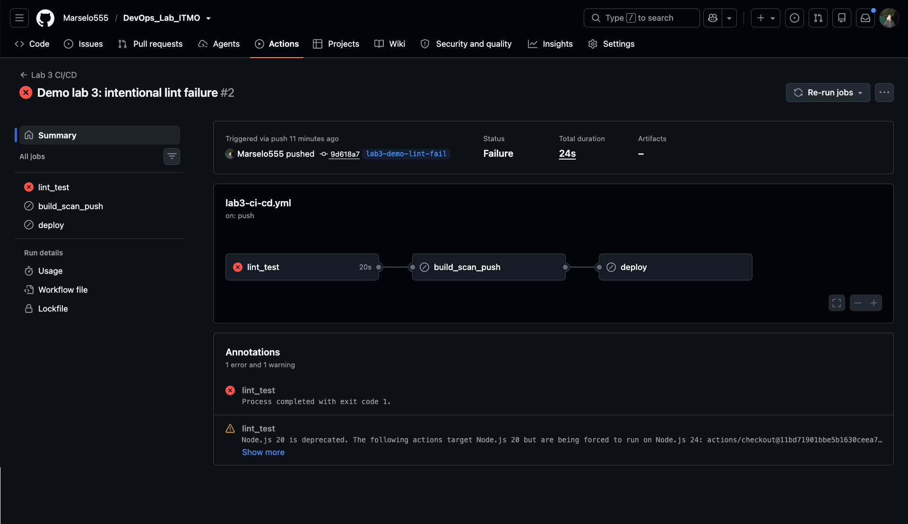
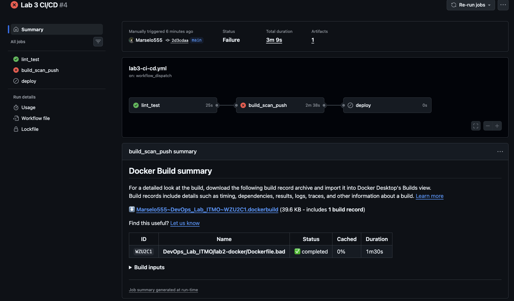
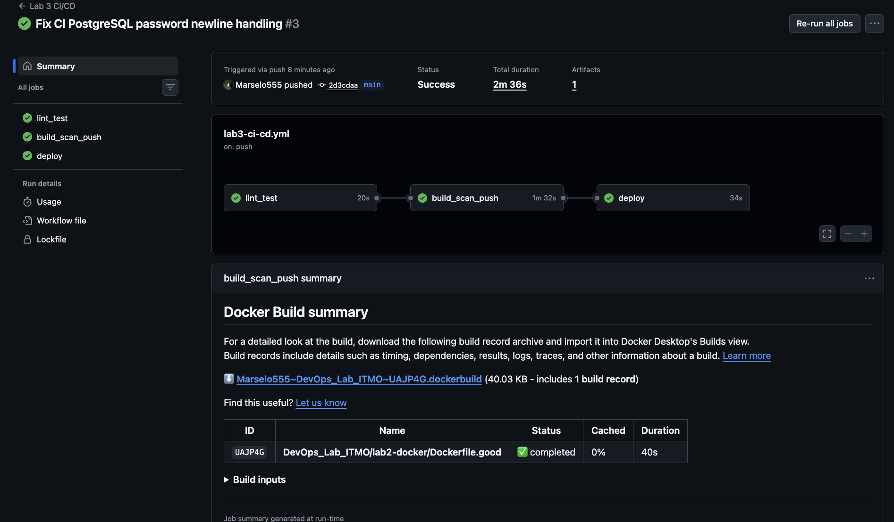

# Лабораторная 3 — CI/CD

## Цель и результат

Цель работы — настроить CI/CD для блокнота из лабораторной 0. Код с ошибкой и образ с CRITICAL CVE должны останавливаться до деплоя. Исправленная версия должна пройти `Lint/Test → Docker Build → Trivy Scan → Push → Deploy → Health Check`. Откат со звёздочкой не выполнялся.

Проверки проведены 10 ноября 2026 года на Mac с архитектурой `arm64` и Docker Desktop Engine 29.9.3. Для деплоя использован self-hosted runner `macbook-devops` (macOS, ARM64). Данные лабораторных 0–2 не удалялись; после деплоя API лабораторной 2 по-прежнему отвечал HTTP 200.

| Прогон GitHub Actions | Результат |
| --- | --- |
| [Код с ошибкой, коммит `9d618a7`](https://github.com/Marselo555/DevOps_Lab_ITMO/actions/runs/42859654550) | Ошибка Ruff `F821`; сборка и деплой пропущены |
| [Исправленная демонстрационная ветка, коммит `b8afe18`](https://github.com/Marselo555/DevOps_Lab_ITMO/actions/runs/42860991565) | Lint, тесты, сборка и Trivy прошли; публикация и деплой для этой ветки отключены |
| [Уязвимый образ, `scan_bad_image=true`](https://github.com/Marselo555/DevOps_Lab_ITMO/actions/runs/42860754501) | 15 CRITICAL; публикация в GHCR и деплой пропущены |
| [Исправленный `main`, коммит `2d3cdaa`](https://github.com/Marselo555/DevOps_Lab_ITMO/actions/runs/42860700694) | Все три задания прошли; образ опубликован в GHCR и развёрнут на Mac, финальный `curl` успешен |
| [Ручной плохой pipeline](https://github.com/Marselo555/DevOps_Lab_ITMO/actions/runs/42860748214) | Образ собран без lint, тестов и Trivy |

Первый запуск `main` для коммита `fbd8559` [завершился ошибкой](https://github.com/Marselo555/DevOps_Lab_ITMO/actions/runs/42859626377): lint прошёл, но тест получил `password authentication failed`. В CI secret оказался завершающий перевод строки. При инициализации официальный образ PostgreSQL использовал первую строку пароля. Проверка во временной Docker-сети повторила ошибку: пароль с переводом строки не прошёл TCP-аутентификацию, без него — прошёл. Коммит `2d3cdaa` убирает завершающие CR/LF только из переменной окружения тестового процесса; пароль в лог не выводится. Следующий прогон прошёл.

## Workflow и исправленные практики

### Плохой: `.github/workflows/lab3-bad.yml`

Этот workflow запускается только вручную (`workflow_dispatch`). Он собирает образ, но не публикует его. [Прогон 42860748214](https://github.com/Marselo555/DevOps_Lab_ITMO/actions/runs/42860748214) завершился успешно.

```yaml
name: Lab 3 bad pipeline demo

on:
  workflow_dispatch:

permissions:
  contents: read

jobs:
  build:
    runs-on: ubuntu-24.04
    steps:
      - uses: actions/checkout@11bd71901bbe5b1630ceea73d27597364c9af683 # v4.2.2
      # BAD: no lint or tests before building.
      # BAD: no dependency or Docker layer cache.
      # BAD: no vulnerability scan.
      - name: Build without quality and security gates
        run: docker build -f lab2-docker/Dockerfile.good -t notebook-bad-pipeline .
```

| Плохая практика | Исправление в хорошем pipeline |
| --- | --- |
| Нет обязательных lint и тестов | Отдельный job `lint_test`: Ruff и CRUD-тест с PostgreSQL |
| Нет кеша зависимостей и Docker-слоёв | pip cache в `setup-python`, Buildx cache в GitHub Actions |
| Нет сканирования уязвимостей | Trivy показывает HIGH/CRITICAL; отдельный gate завершает job с кодом 1 при CRITICAL |

### Хороший: `.github/workflows/lab3-ci-cd.yml`

Версии actions закреплены полными SHA, версии образов указаны явно. Права заданы для каждого задания: `contents: read`, `packages: write` только при публикации и `packages: read` при деплое. Для GHCR используется `GITHUB_TOKEN`. Пароль временной БД хранится в GitHub secret `LAB3_CI_DB_PASSWORD`, пароль локальной БД — в файле `.env`, исключённом из Git.

```yaml
name: Lab 3 CI/CD

on:
  push:
    branches:
      - main
      - 'lab3-demo-*'
  workflow_dispatch:
    inputs:
      scan_bad_image:
        description: 'Scan the vulnerable lab 2 image to demonstrate the security gate'
        type: boolean
        default: false

permissions: {}

jobs:
  lint_test:
    runs-on: ubuntu-24.04
    permissions:
      contents: read
    services:
      db:
        image: postgres:16.13-alpine
        env:
          POSTGRES_USER: notebook
          POSTGRES_DB: notebook_ci
          POSTGRES_PASSWORD: ${{ secrets.LAB3_CI_DB_PASSWORD }}
        ports:
          - 5432:5432
        options: >-
          --health-cmd "pg_isready -U notebook -d notebook_ci"
          --health-interval 5s
          --health-timeout 3s
          --health-retries 10
    env:
      POSTGRES_USER: notebook
      POSTGRES_DB: notebook_ci
      POSTGRES_PASSWORD: ${{ secrets.LAB3_CI_DB_PASSWORD }}
      DB_HOST: 127.0.0.1
      DB_PORT: '5432'
    steps:
      - uses: actions/checkout@11bd71901bbe5b1630ceea73d27597364c9af683 # v4.2.2
      - uses: actions/setup-python@a26af69be951a213d495a4c3e4e4022e16d87065 # v5.6.0
        with:
          python-version: '3.11'
          cache: pip
          cache-dependency-path: |
            backend/requirements.txt
            requirements-ci.txt
      - name: Install CI dependencies
        run: python -m pip install -r requirements-ci.txt
      - name: Lint
        run: ruff check backend tests
      - name: Test CRUD against PostgreSQL
        run: |
          python - <<'PY'
          import os
          import subprocess

          env = os.environ.copy()
          env["POSTGRES_PASSWORD"] = env["POSTGRES_PASSWORD"].rstrip("\r\n")
          subprocess.run(
              ["python", "-m", "unittest", "discover", "-s", "tests", "-v"],
              env=env,
              check=True,
          )
          PY

  build_scan_push:
    needs: lint_test
    runs-on: ubuntu-24.04
    permissions:
      contents: read
      packages: write
    env:
      IMAGE_REF: ghcr.io/marselo555/devops-lab-itmo-notebook:${{ github.sha }}
    steps:
      - uses: actions/checkout@11bd71901bbe5b1630ceea73d27597364c9af683 # v4.2.2
      - uses: docker/setup-qemu-action@29109295f81e9208d7d86ff1c6c12d2833863392 # v3.6.0
      - uses: docker/setup-buildx-action@e468171a9de216ec08956ac3ada2f0791b6bd435 # v3.11.1
      - name: Build the Mac-compatible image
        uses: docker/build-push-action@263435318d21b8e681c14492fe198d362a7d2c83 # v6.18.0
        with:
          context: .
          file: ${{ inputs.scan_bad_image && 'lab2-docker/Dockerfile.bad' || 'lab2-docker/Dockerfile.good' }}
          platforms: linux/arm64
          load: true
          tags: ${{ env.IMAGE_REF }}
          cache-from: type=gha,scope=notebook
          cache-to: type=gha,mode=max,scope=notebook
      - name: Report HIGH and CRITICAL findings
        uses: aquasecurity/trivy-action@ed142fd0673e97e23eac54620cfb913e5ce36c25 # v0.36.0
        with:
          image-ref: ${{ env.IMAGE_REF }}
          version: v0.76.1
          scanners: vuln
          severity: HIGH,CRITICAL
          format: table
          exit-code: '0'
      - name: Block CRITICAL findings
        uses: aquasecurity/trivy-action@ed142fd0673e97e23eac54620cfb913e5ce36c25 # v0.36.0
        with:
          image-ref: ${{ env.IMAGE_REF }}
          version: v0.76.1
          scanners: vuln
          severity: CRITICAL
          format: table
          exit-code: '1'
      - name: Login to GHCR
        if: github.ref == 'refs/heads/main'
        uses: docker/login-action@184bdaa0721073962dff0199f1fb9940f07167d1 # v3.5.0
        with:
          registry: ghcr.io
          username: ${{ github.actor }}
          password: ${{ secrets.GITHUB_TOKEN }}
      - name: Publish checked image
        if: github.ref == 'refs/heads/main'
        run: docker push "$IMAGE_REF"

  deploy:
    if: github.ref == 'refs/heads/main'
    needs: build_scan_push
    runs-on: [self-hosted, macOS, ARM64]
    permissions:
      contents: read
      packages: read
    env:
      IMAGE_REF: ghcr.io/marselo555/devops-lab-itmo-notebook:${{ github.sha }}
      LAB3_ENV_FILE: /Users/marsel/Desktop/itmo/Cloud/.env
    steps:
      - uses: actions/checkout@11bd71901bbe5b1630ceea73d27597364c9af683 # v4.2.2
      - name: Check Mac and Docker Desktop
        shell: bash
        run: |
          test "$(uname -m)" = arm64
          test -f "$LAB3_ENV_FILE"
          docker info --format 'Docker Engine {{.ServerVersion}}'
      - name: Login to GHCR and pull published image
        shell: bash
        env:
          GHCR_TOKEN: ${{ secrets.GITHUB_TOKEN }}
        run: |
          printf '%s' "$GHCR_TOKEN" | docker login ghcr.io -u "$GITHUB_ACTOR" --password-stdin
          docker pull "$IMAGE_REF"
          test "$(docker image inspect "$IMAGE_REF" --format '{{.Architecture}}')" = arm64
      - name: Deploy three services without building
        shell: bash
        run: |
          BACKEND_IMAGE="$IMAGE_REF" FRONTEND_PORT=8083 \
            docker compose -p devops-lab3 --env-file "$LAB3_ENV_FILE" \
            -f lab2-docker/compose.yaml up --no-build --pull missing --wait --wait-timeout 120
          expected=$(docker image inspect "$IMAGE_REF" --format '{{.Id}}')
          running=$(docker inspect devops-lab3-backend-1 --format '{{.Image}}')
          test "$expected" = "$running"
      - name: Final HTTP health check
        shell: bash
        run: |
          response=$(curl --fail --silent --show-error http://127.0.0.1:8083/api/notes)
          printf 'GET /api/notes HTTP 200\n%s\n' "$response"
```

Образ для `linux/arm64` собирается и сканируется на GitHub-hosted Ubuntu. На Mac runner работают `checkout` и команды shell/Docker CLI через Docker Desktop; service containers и container actions на нём не запускаются. Задание `build_scan_push` начинается после `lint_test`, а `deploy` — после `build_scan_push`. Публикация и деплой разрешены только для `main`. Ручной запуск с `scan_bad_image=true` проверяет плохой Dockerfile до публикации. Compose запускает скачанный из GHCR образ с тегом по полному SHA и флагом `--no-build`. PostgreSQL использует отдельный именованный том `devops-lab3_notes_data`; `down -v` не выполняется.

Оба YAML прошли `actionlint:1.7.12` с кодом 0. Локальная команда `.venv/bin/ruff check backend tests` вернула `All checks passed!`; CRUD-тест с PostgreSQL лабораторной 0 завершился `Ran 1 test ... OK`. Результаты запусков в GitHub приведены выше.

## Плохой код и блокировка деплоя

В отдельной ветке `lab3-demo-lint-fail` коммит `9d618a7` добавил `tests/test_ci_lint_failure.py` с неопределённым именем. В [журнале упавшего прогона](https://github.com/Marselo555/DevOps_Lab_ITMO/actions/runs/42859654550):

```text
F821 Undefined name `undefined_ci_symbol`
Found 1 error.
Process completed with exit code 1.
```

`lint_test` завершился со статусом failure; `build_scan_push` и `deploy` были пропущены. Ошибку исправили отдельным коммитом `b8afe18`. В `main` намеренно сломанного кода не было. [Повторный прогон ветки](https://github.com/Marselo555/DevOps_Lab_ITMO/actions/runs/42860991565) завершился со статусом success: lint, CRUD-тест и Trivy прошли. Публикация и деплой для демонстрационной ветки по условию workflow остались пропущенными.

## Trivy: до и после

Trivy `v0.76.1` запускался со сканером `vuln` и уровнями `HIGH,CRITICAL`. В таблице приведены результаты GitHub Actions. Предварительное локальное сканирование другой сборки плохого образа дало 15 CRITICAL и 275 HIGH; в GitHub-прогоне — 15 CRITICAL и 373 HIGH. При сравнении использованы показатели из GitHub-прогонов.

| Образ | CRITICAL | HIGH | Gate |
| --- | ---: | ---: | --- |
| Плохой `lab2-docker/Dockerfile.bad` на полном `python:3.11`, [run 42860754501](https://github.com/Marselo555/DevOps_Lab_ITMO/actions/runs/42860754501) | 15 | 373 | FAIL, `Block CRITICAL findings` exit 1 |
| Хороший `lab2-docker/Dockerfile.good` на `python:3.11.18-alpine3.23`, [run 42860700694](https://github.com/Marselo555/DevOps_Lab_ITMO/actions/runs/42860700694) | 0 | 2 | PASS, публикация разрешена |

В плохом образе Trivy обнаружил, в частности, `CVE-2026-44172` в MariaDB, `CVE-2026-42216` в OpenEXR, `CVE-2026-6653` в libxml2 и `CVE-2026-60002` в OpenSSH. Эти системные пакеты входят в тяжёлый базовый образ и не нужны блокноту. Хороший multi-stage образ собран на свежем Alpine; перечисленных CRITICAL в нём нет. Две оставшиеся HIGH относятся к `jaraco.context 5.3.0` (`CVE-2026-23949`) и `wheel 0.45.1` (`CVE-2026-24049`) из Python-образа. По условию задания gate блокирует CRITICAL, а HIGH остаются видны в журнале. Уязвимости не скрывались через ignore-файлы Trivy; gate не обходили.

В [красном security-run](https://github.com/Marselo555/DevOps_Lab_ITMO/actions/runs/42860754501) журнал содержит:

```text
Total: 388 (HIGH: 373, CRITICAL: 15)
Total: 15 (CRITICAL: 15)
Process completed with exit code 1.
```

Шаги `Login to GHCR` и `Publish checked image`, а также задание `deploy` были пропущены. В успешном прогоне журнал Trivy содержит `Total: 2 (HIGH: 2, CRITICAL: 0)`; проверка на CRITICAL прошла. База Trivy обновляется, поэтому workflow сканирует образ перед каждой публикацией.

## GHCR, Mac deploy и финальный curl

[Прогон 42860700694](https://github.com/Marselo555/DevOps_Lab_ITMO/actions/runs/42860700694) завершился со статусом success во всех трёх заданиях: `lint_test`, `build_scan_push` и `deploy`. В журнале публикации образа:

```text
2d3cdaa3362f2f6d6e10fbd431bc60610776ca09: digest: sha256:b6311e5e8ffde984010a38411ae819e61575fa4166a84cd8f29855b2b5710b68 size: 1989
```

Полный тег: `ghcr.io/marselo555/devops-lab-itmo-notebook:2d3cdaa3362f2f6d6e10fbd431bc60610776ca09`. Задание на Mac вывело `Docker Engine 29.9.3` и `Status: Downloaded newer image` для этого тега, затем запустило три контейнера. Команды `docker image inspect` и `docker inspect devops-lab3-backend-1` вернули один image ID: `sha256:b6311e5e8ffde984010a38411ae819e61575fa4166a84cd8f29855b2b5710b68`. Архитектура образа — `arm64`, статус бэкенда — `healthy`. Том `devops-lab3_notes_data` существует. Совпадение ID подтверждает запуск опубликованного образа без локальной пересборки.

Финальный шаг **Final HTTP health check** в том же GitHub run:

```text
GET /api/notes HTTP 200
[]
```

На Mac команда `curl --fail --silent --show-error http://127.0.0.1:8083/api/notes` также вывела `[]`. Команда `docker compose -p devops-lab3 --env-file .env -f lab2-docker/compose.yaml ps` показала три запущенных сервиса: frontend, backend и db. Страница доступна на `http://127.0.0.1:8083/`; пустой список означает, что в отдельной базе лабораторной 3 ещё нет заметок.

## Команды для повторения и безопасной остановки

```zsh
open http://127.0.0.1:8083/
curl --fail --silent --show-error http://127.0.0.1:8083/api/notes
docker compose -p devops-lab3 --env-file .env -f lab2-docker/compose.yaml ps
docker volume inspect devops-lab3_notes_data --format '{{.Name}}'
```

Плохой workflow можно запустить вручную: Actions → **Lab 3 bad pipeline demo** → Run workflow. Для проверки Trivy выберите **Lab 3 CI/CD** → Run workflow с `scan_bad_image=true`. Отправка коммита в `main` запускает полный pipeline. Остановить только стек лабораторной 3 можно командой:

```zsh
docker compose -p devops-lab3 --env-file .env -f lab2-docker/compose.yaml stop
```

Не используйте `down -v`: он удалит заметки из тома. Перед сдачей прочитайте указанную в DOCX [историю про Васю](https://habr.com/ru/articles/689234/).

## Скриншоты

Скриншоты прогонов GitHub Actions:

**Ошибка lint:** `lint_test` завершился с ошибкой, сборка и деплой пропущены.



**Блокировка Trivy:** `build_scan_push` завершился с ошибкой, деплой пропущен. В сводке видна сборка `Dockerfile.bad`.



**Успешный прогон:** `lint_test`, `build_scan_push` и `deploy` прошли. Вывод финального `curl` приведён выше и доступен в журнале.



## Проверка требований обычной лабораторной 3

| Требование | Статус | Реальное подтверждение / действие |
| --- | --- | --- |
| Плохой и хороший работающие pipelines | PASS | Оба YAML прошли actionlint; ручной плохой [run 42860748214](https://github.com/Marselo555/DevOps_Lab_ITMO/actions/runs/42860748214) собрал образ |
| Минимум три bad practices и исправления | PASS | Нет lint/test, кеша, Trivy в плохом; все три есть в хорошем |
| Lint/test блокирует плохой код до деплоя | PASS | [Красный run 42859654550](https://github.com/Marselo555/DevOps_Lab_ITMO/actions/runs/42859654550): Ruff F821, downstream jobs skipped |
| Исправленный код проходит повторную проверку | PASS | [Run 42860991565](https://github.com/Marselo555/DevOps_Lab_ITMO/actions/runs/42860991565) success |
| Кеш, закреплённые версии, минимальные permissions и секреты | PASS | Проверены YAML, actionlint и GitHub логи; секреты не в репозитории |
| Build образа лабораторной 2 для Mac | PASS | GitHub build success; скачанный на Mac образ `arm64` |
| Trivy до/после и блокировка CRITICAL | PASS | 15/373 → 0/2; [красный security-run](https://github.com/Marselo555/DevOps_Lab_ITMO/actions/runs/42860754501), push/deploy skipped |
| Публикация в GHCR только после проверок | PASS | [Зелёный run](https://github.com/Marselo555/DevOps_Lab_ITMO/actions/runs/42860700694), опубликованный digest и успешный `docker pull` на Mac |
| Self-hosted Mac runner и Docker Desktop | PASS | `macbook-devops` online; deploy job success, Docker Engine 29.9.3 |
| Деплой именно GHCR-образа без удаления тома | PASS | Совпали image ID; `devops-lab3_notes_data` существует, в workflow нет `down -v` |
| Финальный curl в GitHub Actions | PASS | В журнале зелёного run `GET /api/notes HTTP 200` и `[]` |
| Скрин красного и зелёного прогонов в отчёте | PASS | Три настоящих PNG из GitHub Actions вложены выше |
